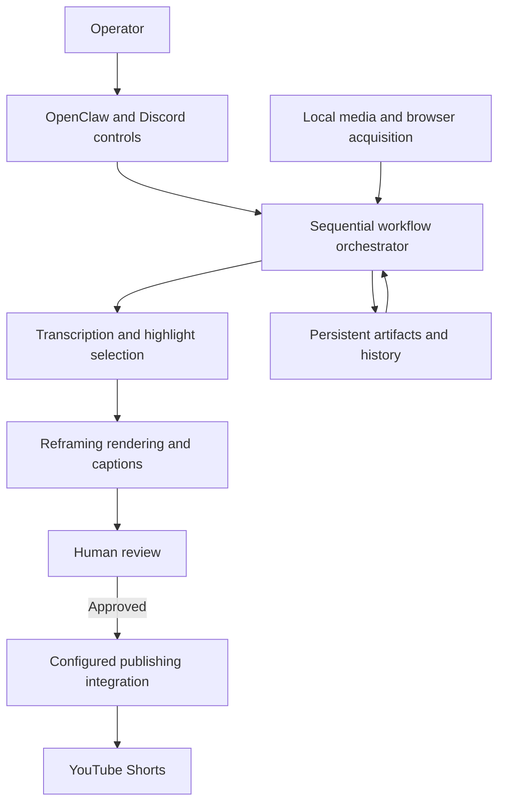

# Prod

**OpenClaw-integrated video automation, from source discovery to approved YouTube Shorts publishing.**

Prod transforms longer videos into short-form content through a coordinated workflow for discovery, transcription, highlight selection, vertical editing, captions, review, and publishing. It has successfully generated short-form videos and automatically published them to **YouTube Shorts** through its configured publishing integration.

I designed and implemented the complete application codebase, integrating OpenClaw, AI services, and media-processing tools. This repository presents the architecture, engineering decisions, and four runnable code demonstrations. The full application remains proprietary.

## The engineering problem

Producing a short video involves more than cutting a time range. Source acquisition, transcript timestamps, highlight proposals, crop movement, subtitle timing, delivery limits, and publishing metadata must agree on the same output. Human review also separates processing from the final publishing action.

Prod connects those steps through specialist application modules coordinated by an explicit orchestrator. AI services supply transcription and content proposals; deterministic code manages selection, media transformations, state, and workflow progression.

## Capabilities

- **Discover and acquire sources:** rank local and browser-discovered candidates, stage selected media, and retain source provenance.
- **Select highlights with AI assistance:** combine transcript-derived candidates and model proposals with deterministic scoring, duration checks, duplicate removal, and temporal spacing.
- **Render vertical clips:** use face-aware local reframing, subject continuity, smoothed crop movement, and fallback crop plans.
- **Generate captions:** convert transcript timing into clip-relative cues, produce SRT and styled ASS subtitles, and apply captions to the video.
- **Prepare human review:** assemble proposed titles, a description, source information, caption status, and a size-checked preview while retaining the publishing asset separately.
- **Publish approved content:** resume from saved review artifacts and hand the final asset to the configured publishing integration. Source and segment history inform later selection.

## Architecture



The specialist roles are coordinated application stages. AI model calls operate within that sequence; the architecture does not depend on independently autonomous agent sessions. OpenClaw provides the integration and control surface, while the application owns the media workflow.

Read the [architecture](docs/ARCHITECTURE.md) for component responsibilities and the approval handoff.

## Technology stack

| Area | Technologies |
| --- | --- |
| Application and controls | JavaScript ES modules, Node.js, TypeScript OpenClaw plugin, Discord |
| AI processing | OpenAI audio transcription, Google Gemini highlight and metadata generation |
| Media | FFmpeg, ffprobe, H.264/AAC output, SRT and ASS subtitles |
| Local face analysis | PowerShell and Windows Runtime face detection |
| Integration and state | Subprocess bridges, native HTTP APIs, filesystem JSON artifacts, JSON Lines message spooling |

## End-to-end workflow

1. Submit a topic and source mode through the control surface or command-line entry point.
2. Discover candidates, select a source, acquire its media, and record provenance.
3. Prepare audio, transcribe it, and normalize timing onto the source timeline.
4. Rank highlight candidates and choose the clip window with selection history in view.
5. Render the vertical clip, reframe it, and generate clip-relative captions.
6. Prepare a review package with metadata and a separate preview suited to delivery constraints.
7. On approval, load the saved package and automatically publish through the configured integration.

## Engineering decisions

The implementation keeps AI proposals separate from deterministic selection, makes source and clip timelines explicit, and translates crop paths into time-dependent media expressions. Measured file sizes guide media preparation, while separate review and publishing assets preserve the prepared output across the human approval boundary.

The [engineering notes](docs/ENGINEERING.md) explain these decisions and their practical limits.

## Code demonstrations

| Demonstration | Focus | Provenance |
| --- | --- | --- |
| [FFmpeg crop-expression compiler](examples/compile-crop-expression.mjs) | Keyframes, interpolation, expression generation | Conceptual demonstration |
| [Preview size selection](examples/select-preview-by-size.mjs) | Measured byte budgets and asynchronous attempts | Conceptual demonstration |
| [Caption timeline alignment](examples/align-caption-intervals.mjs) | Interval intersection and source-to-clip conversion | Conceptual demonstration |
| [JSON request validation](examples/validate-json-request.mjs) | Asynchronous byte streams and defensive validation | Adapted and extended excerpt |

These examples isolate engineering concepts using synthetic data. They have their own contracts and safeguards; they are not an unchanged copy of the production pipeline. See [example usage, provenance, and testing](docs/EXAMPLES.md).

From this repository's root, run the dependency-free Node.js tests:

```sh
node --test
```

FFmpeg enables three additional native checks using generated signals and test frames. Without a local FFmpeg executable, those checks explicitly skip. The tests validate these demonstrations, not the production publishing integration.

## Project status and source availability

**Operational:** Prod has completed video generation and automated YouTube Shorts publication. Its privately configured publishing bridge is not included in this showcase.

The full application source, agent instructions, operational configurations, and production artifacts remain private. This repository demonstrates the system through technical documentation, synthetic examples, and selected code demonstrations, without distributing actual generated videos.
