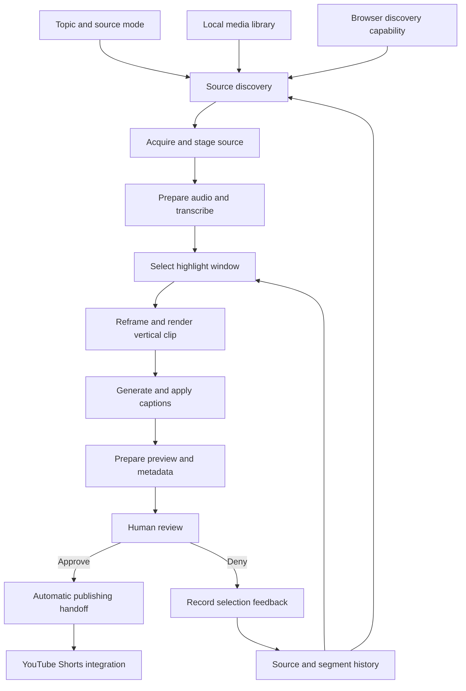
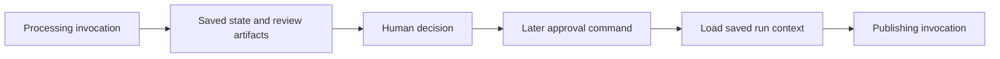

# Architecture

[Project overview](../README.md) · [Engineering](ENGINEERING.md) · [Code demonstrations](EXAMPLES.md)

Prod integrates OpenClaw and Discord controls with a Node.js media-processing workflow. It coordinates specialist application modules, invokes AI and media capabilities through adapters, and persists artifacts that connect processing, human review, and automatic publishing.

## Control and orchestration

The OpenClaw plugin exposes pipeline controls through a tool and registered commands. Command skills provide deterministic dispatch for starting a run, reviewing its output, recording a decision, and inspecting progress. Command-line entry points reach the same application orchestration layer.

Long-running work is started asynchronously from the control surface and reports progress through stage messages and saved state. Within a run, stages are awaited in sequence because later stages consume earlier results. This is orchestration of specialist modules; the stage names do not imply separate autonomous model sessions.

Adapters separate workflow responsibilities from external capabilities. Configured subprocess bridges exchange structured data with the application, while local media operations invoke installed tools. This keeps service and executable integration outside the stage-sequencing logic.

## Processing stages

| Responsibility | Input | Result |
| --- | --- | --- |
| Orchestrator | Parsed command and run context | Ordered stage execution and saved progress |
| Scout | Topic, available sources, and history | Ranked source candidates |
| Ingest | Selected candidate | Staged media and provenance |
| Editor | Source media and transcript | Selected timing window and vertical clip |
| Captioner | Selected transcript cues and rendered clip | Subtitle artifacts and prepared video |
| Review | Prepared clip and proposed metadata | Human-readable package and delivery preview |
| Publisher | Saved review package after approval | Final-asset handoff and publication result |

### Source discovery and ingestion

Local, browser, and hybrid modes determine where candidates are discovered. The local path considers available video files; the browser path uses a configured capability. Candidate ranking combines topic relevance with source history. Ingestion copies or acquires the selected media and preserves its provenance for later review.

Browser acquisition supports a direct-download attempt followed by an extraction fallback when the first attempt fails. Its live implementation belongs to the configured environment rather than the code demonstrations in this repository.

### Transcription and highlight selection

Audio preparation accounts for transcription-service input constraints. Independently timed results are normalized onto a common source timeline so later stages can work with consistent timestamps. The adaptive transcription preparation strategy remains private; this showcase discusses its responsibilities without reproducing its chunking implementation.

Gemini supplies highlight proposals, and deterministic application logic builds and evaluates transcript-derived candidates. Duration checks, candidate ordering, duplicate removal, temporal spacing, and prior selection history contribute to the final choice. The selected window carries a reason and timing information into rendering and review.

### Rendering and captions

The local rendering path uses ffprobe for source information and sampled frames for Windows face analysis. Geometric continuity and crop planning support horizontal reframing into a vertical composition. Dynamic crop positions become a time-dependent FFmpeg expression; static and centered plans provide alternative framing paths when appropriate.

This is geometric face-aware reframing, rather than biometric recognition or audio-based active-speaker identification. Local face analysis uses Windows capabilities; configured media bridges provide another rendering boundary.

Captions use available word timings, with synthesized timing when needed. Token normalization, cue grouping, source-to-clip alignment, and timing stabilization produce readable subtitle artifacts. SRT and styled ASS output support caption burning, including a simpler-format fallback when the preferred burn fails.

### Review and automatic publishing

Review combines proposed titles and descriptive copy with source provenance, selected timestamps, and caption status. A separate preview is prepared against a delivery-size budget. The publishing asset retains its own reference, allowing the review preview to be compressed without replacing the final prepared media.

Approval starts the publishing handoff from saved artifacts. Prod has successfully used its configured integration to publish to YouTube Shorts. That live publishing bridge remains private and is not part of this showcase.

## Persistence across human review

The processing invocation can finish while the run awaits a human decision. A later command reconstructs the run context and reads the review package, allowing publication to happen in another invocation without holding the original processing process open.

Persistent material serves several purposes:

- **Run state:** identifies current progress and outcome for operator inspection.
- **Stage artifacts:** preserve transcript, selection, rendering, and caption results for diagnosis.
- **Review and publishing records:** connect the reviewed media to the later publishing handoff.
- **Source and segment history:** record usage and decisions that influence later ranking.
- **Logs and message spooling:** retain local operational evidence, including messages produced when an optional messaging bridge is absent.

History feeds deterministic selection policy; it does not retrain a model. File-backed artifacts enable the approval handoff and inspection, while broader transactional or distributed-execution guarantees are separate concerns.

## What the showcase contains

The four demonstrations expose selected mathematical, data-transformation, and asynchronous-control concepts with synthetic inputs. They are separate from the private stage implementations, prompts, integration configuration, and runtime artifacts. Their precise relationship to production is documented in [EXAMPLES.md](EXAMPLES.md).
